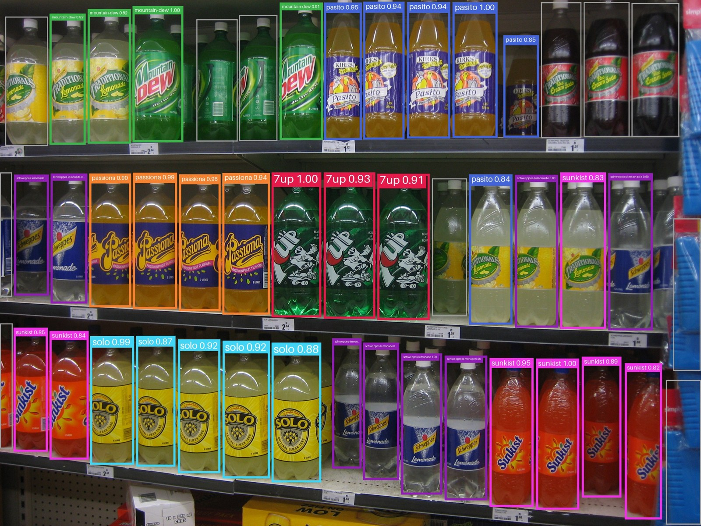
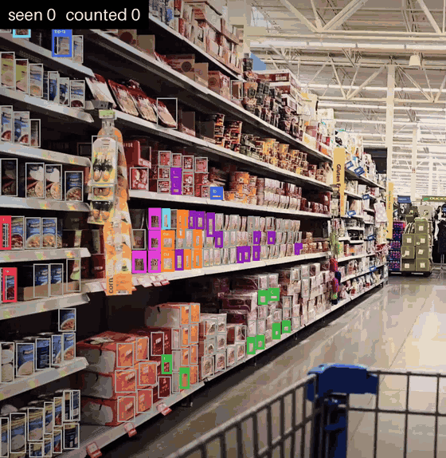

# 🔎 SkuScope

**Recognize retail SKUs on shelf photos and videos.** YOLO finds every product on the shelf, DINO tells which SKU each one is. In a video, each product is tracked across frames and counted once.

🇧🇷 [Leia em português](README.pt-BR.md)

> Study project. It is meant for learning and experimentation, not for production use.


<sub>Catalog of 7 SKUs, **one photo each**, no training. Gray boxes are "unknown". Photo: [Soft drink shelf](https://commons.wikimedia.org/wiki/File:Soft_drink_shelf.JPG), public domain.</sub>

## Why this approach

The classic way to recognize products is to train a classifier with one class per SKU. Every time the assortment changes you retrain, and the model tends to forget old products.

SkuScope splits the problem in two:

1. **Where are the products?** A YOLO11 detector trained on [SKU-110K](https://github.com/eg4000/SKU110K_CVPR19) finds every product on the shelf. It knows only one class, "product".
2. **Which product is it?** Each crop becomes a vector (a "visual fingerprint") with [DINOv2](https://github.com/facebookresearch/dinov2). That vector is compared, by cosine similarity, with the vectors of your catalog photos.

**Adding a new SKU means adding a few photos to a folder.** No training involved.

```
Shelf photo
   ↓  YOLO11 (SKU-110K)        finds every product
Product crops
   ↓  DINOv2                   one vector per crop
Vectors  ──►  cosine similarity against every catalog photo
   ↓
Similarity to each SKU (its best photo)
   ↓
≥ threshold and ahead of the runner-up by the margin → SKU
close call only among variants of one product line   → the product line
anything else                                         → "unknown"
```

### Why DINO and not CLIP?

CLIP learned from image captions, so it knows *concepts* ("a can of cola"). DINO learned from images alone (self-supervised), so it pays attention to *visual detail*: texture, logos, the thin band that separates "Original" from "Zero". That detail is what separates look-alike SKUs.

## Results on the example shelf

Seven brands went into the catalog with **one cropped photo each**. Two brands (Traditional's Lemonade and Cream Soda, 10 bottles in total) were left out on purpose, to see how the model handles products it does not know. Each of the 48 detections was checked by hand.

| What | Result |
|---|---|
| Bottles detected by YOLO | 48 (44 bottles + 4 partial or non-product boxes at the edges) |
| **Cataloged brands, top-1 SKU** | **34 / 34 correct**, including a bottle seen from the back |
| Similarity, correct matches | mostly 0.80–0.96 (lowest 0.66, the back-facing bottle) |
| Similarity, brands *not* in the catalog | 0.67–0.84 |
| Similarity, partial boxes at the edges | ≤ 0.45 |
| Full run on a MacBook M2 Pro | about 7 s, including model loading (detection takes about 1 s) |

**Takeaway:** picking the right SKU among the known ones is the easy part. **The hard part is saying "I don't know this product".** Unknown products still score up to 0.84, so no single threshold separates them perfectly:

| Rule | Known bottles named (of 34) | Unknown bottles with a wrong label |
|---|---|---|
| Threshold 0.80 alone | 31 | 5 |
| Threshold 0.85 alone | 26 | 0 |
| **Threshold 0.80 + margin 0.03** (the default) | **30** | **1** |

What helps is the **margin**: a product gets a name only when its best SKU beats the second best by at least 0.03. A bottle the catalog does not know tends to look a bit like several SKUs at once, so its top two scores are close; a known bottle usually wins clearly. The image above uses the default.

These numbers are optimistic: the catalog crops came from the same photo, with the same light and angle. With catalog photos taken separately, expect lower scores and calibrate the threshold with the web demo.

## Videos: counting each product once


<sub>Output of `skuscope video` (left part of the frame) on 4.5 s of a [stock clip](https://www.pexels.com/video/shopping-aisle-perspective-on-supermarket-essentials-29376327/) (Pexels). Catalog of 12 products, 51 photos taken from other frames of the same clip.</sub>

On a photo, counting means adding up the labels. On a video, the same product shows up in dozens of frames, so the frames cannot simply be added up. `skuscope video` follows each product from frame to frame and counts it once.

No model is involved in the tracking: it is classic computer vision (OpenCV) plus a few rules.

1. **Camera motion.** Between two frames, ORB features are matched and a homography (RANSAC) describes how the image moved.
2. **Matching.** Every product already tracked is moved by that homography, then matched to the new boxes by overlap (IoU). Without this step, a camera moving 40 px per frame leaves almost no overlap between frames, and products get new identities.
3. **Short gaps.** A product lost to motion blur for up to 30 frames (1 s) is found again where the camera motion put it, with the same identity.
4. **Stable names.** Each product keeps a running average of its per-SKU scores, so one blurry frame does not change its name.
5. **Counting.** A product is counted after being named in 3 frames, once, with the name it had then.

```bash
skuscope video data/shelves/aisle.mp4 --threshold 0.65 --margin 0.05 --motion-region 0 0.5
```

```
135 frames, 1099 different products seen, 415 counted → outputs/aisle_skuscope.mp4
  cup-noodles                      88
  case-beige                       87
  cup-noodles-family               62
  top-ramen-pack                   48
  ...
```

This clip has heavy motion blur, so it uses a lower threshold and a larger margin than the defaults. `cup-noodles-family` is a product line (see [product lines](#5-optional-product-lines)).

One homography describes one plane. Rolling down an aisle, the left shelf, the right shelf and the floor move differently, so `--motion-region 0 0.5` estimates the motion from the left half of the frame only. The table counts the products of the left shelf in the same 4.5 s, running the tracker on the detections saved by the demo-video scripts (crops from the 4K original, so more products get a name than in the 1920 px run above):

| Tracking | Products counted | Suspected duplicates |
|---|---|---|
| IoU only, no camera motion | 607 | 15% |
| Camera motion from the whole frame | 525 | 12% |
| **Camera motion from the left half** (`--motion-region 0 0.5`) | **471** | **5%** |

A suspected duplicate is a counted product that shows up where the camera motion predicts a product with the same name, counted before and since lost. It is an estimate: nobody counted the unique products of the clip by hand.

### Accuracy on video, against hand-labelled frames

| Scene | Products named right | Wrong name |
|---|---|---|
| Dairy wall, 35 products, 5–6 photos each | 174 of 196 (89%) | 10 |
| Noodle aisle (the clip above), 12 products | 129 of 167 (77%), 45 of them by product line | 7 |

The remaining mistakes are lookalikes: cream cheese vs. cottage cheese of the same brand, ricotta vs. mascarpone. These numbers are optimistic, because the catalog photos come from other frames of the same footage, with the same light and angle. They were measured with the scripts behind the demo video, which use this same method.

## Quick start

Tested on a MacBook with Apple M2 Pro (16 GB). DINO runs on the GPU through MPS. Linux and Windows should work too, using CPU or CUDA.

```bash
git clone https://github.com/escudero/skuscope.git
cd skuscope
python3 -m venv .venv && source .venv/bin/activate
pip install -e ".[app]"
```

Model weights download on first use, about 200 MB in total (YOLO11s and DINOv2-small).

To reproduce the results above first, the catalogs and step-by-step commands are in [`examples/`](examples/README.md).

### 1. Photograph your catalog

Pick 5 to 10 products and take **3 to 5 photos of each**, with one product per photo and a few different angles. Save them in one folder per SKU:

```
data/catalog/
├── coca-cola-350ml/
│   ├── 1.jpg
│   ├── 2.jpg
│   └── 3.heic        ← iPhone photos work as they are
├── guarana-antarctica-350ml/
│   └── ...
└── nescau-400g/
    └── ...
```

### 2. Build the catalog index

```bash
skuscope build-catalog data/catalog
```

YOLO crops each photo to its largest product, DINO turns the crop into a vector, and the index is saved to `index/`.

### 3. Recognize a shelf

```bash
skuscope recognize data/shelves/my-shelf.jpg --json outputs/my-shelf.json
```

```
42 products detected → outputs/my-shelf_skuscope.jpg
  coca-cola-350ml                  12
  guarana-antarctica-350ml          9
  unknown                          21
```

### 4. Recognize a video

```bash
skuscope video data/shelves/my-aisle.mp4
```

It writes the annotated video to `outputs/my-aisle_skuscope.mp4` and prints how many different products it saw and counted. It is not real time: on an M2 Pro it processes about 0.4 frames per second at 1920 px.

### 5. Optional: product lines

Variants of one product line (flavors, sizes, light versions) can be almost identical on the shelf. List them in `data/catalog/families.json`:

```json
{
  "cup-noodles": ["cup-noodles-chicken", "cup-noodles-beef", "cup-noodles-shrimp"]
}
```

When the doubt is only among those siblings, the product gets the product line name (`cup-noodles`) instead of a guessed flavor, or "unknown". Run `build-catalog` again after changing the file.

### 6. Web demo

```bash
skuscope app
```

This opens a Gradio page where you upload a photo and adjust the similarity threshold, the margin and the detection confidence live.

## Tuning

| Option | Default | What it does |
|---|---|---|
| `--threshold` | `0.8` | Minimum cosine similarity to accept a SKU. Raise it for fewer wrong labels, lower it for fewer "unknown". With DINOv2, even different products score 0.6–0.8. |
| `--margin` | `0.03` | How much the best SKU must beat the second best. Raise it for fewer wrong labels on lookalikes; `0` turns it off. |
| `--conf` | `0.25` | YOLO detection confidence. |
| `--detector` | `s` | `n` is faster, `s` is more accurate. |
| `--embedder` | `dinov2-small` | `dinov2-base` is more accurate and slower. `dinov3-small` is not tested yet, and it is gated on Hugging Face: accept its license and run `hf auth login` first. |
| `--no-crop` | off | Use the whole catalog photo instead of the largest detected product. |
| `--motion-region` | `0 1` | `video` only: estimate the camera motion from this part of the width, as fractions. Use the side of the shelf you want to count. |

## Limitations

- **Near-identical variants** ("Original" vs "Zero", 350 ml vs 600 ml) may differ only in printed text. Vision alone struggles with them; adding OCR is the natural next step.
- **Dense, high-resolution shelves:** the detector runs at 640 px, so tiny products in very wide photos can be missed. Crop the photo or photograph closer.
- **Occluded or backwards products** are hard for any approach.
- **Products that are not in the catalog** can still score high and receive a wrong label (see the results above).
- **Close-ups in the catalog:** the detector was trained on dense shelves. On a photo of a single product it often finds nothing, or only a piece of the label. When the largest box covers less than 20% of the photo, SkuScope uses the whole photo instead.
- The similarity threshold depends on your products and photos. Calibrate it with the web demo.
- **Video is slow:** every frame goes through YOLO and DINO, about 0.4 frames per second on an M2 Pro. Fast pans with heavy motion blur lose products for more than 1 s and count them again.

## Roadmap ideas

- [ ] Compare DINOv2, DINOv3 and CLIP on the [RP2K](https://www.pinlandata.com/rp2k_dataset/) dataset
- [ ] OCR to tell apart variants with the same packaging
- [ ] Planogram check: compare the recognized product sequence with the expected layout
- [ ] Image tiling for very wide shelf photos
- [x] Margin between the top two SKUs, and product lines for lookalike variants
- [x] Video: follow the camera motion and count each product once
- [ ] Better "unknown" detection with "distractor" photos of products you do not sell
- [ ] Faster video: detect every few frames and let the tracker fill the gaps
- [ ] Approximate nearest-neighbor search (FAISS) for catalogs with millions of photos. On macOS, FAISS from pip and PyTorch each bundle their own `libomp`, which crashes the process.

## Models and licenses

| Component | Source | License |
|---|---|---|
| SkuScope code | this repo | [AGPL-3.0](LICENSE). Ultralytics YOLO is AGPL-3.0. |
| Detector | [chistopat/sku110k-yolo11-object-detector](https://huggingface.co/chistopat/sku110k-yolo11-object-detector) (ONNX, pinned revision, SHA-256 verified) | Follows the [SKU-110K dataset terms](https://github.com/eg4000/SKU110K_CVPR19) (research use) |
| Embedder | [facebook/dinov2-small](https://huggingface.co/facebook/dinov2-small) | Apache-2.0 |
| Example photo | [Soft drink shelf](https://commons.wikimedia.org/wiki/File:Soft_drink_shelf.JPG), Wikimedia Commons | Public domain |
| Example video | [Shopping aisle perspective](https://www.pexels.com/video/shopping-aisle-perspective-on-supermarket-essentials-29376327/), Pexels | [Pexels license](https://www.pexels.com/license/) |

The detector is loaded from its ONNX export instead of the `.pt` checkpoint. Loading a third-party `.pt` file can run arbitrary code (pickle); loading ONNX cannot.

## Credits and references

- Goldman et al., *Precise Detection in Densely Packed Scenes* (CVPR 2019). This is the SKU-110K dataset.
- Oquab et al., *DINOv2: Learning Robust Visual Features without Supervision* (2023)
- *Real-time retail planogram compliance application using computer vision and virtual shelves*, Scientific Reports. Few-shot SKU recognition across 7-Eleven stores in Taiwan. [link](https://www.nature.com/articles/s41598-025-27773-5)
- [Ultralytics YOLO](https://github.com/ultralytics/ultralytics)

## Development

```bash
pip install -e ".[dev]"
pytest
```
